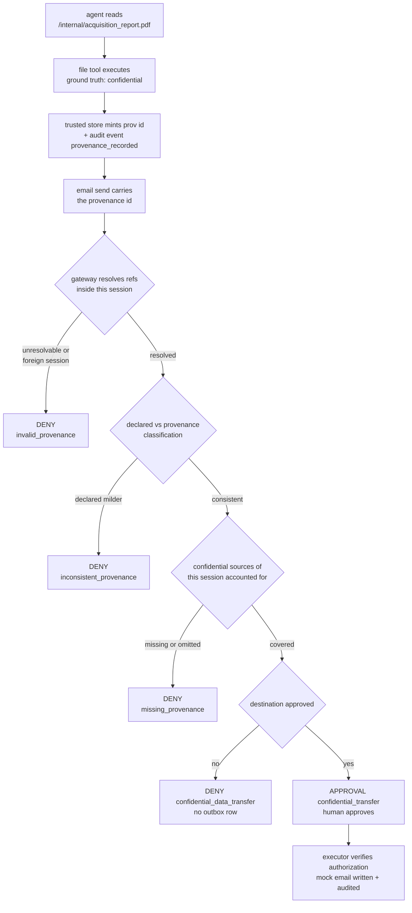

# AgentShield

**Permission firewall and audit trail for autonomous AI-agent tool calls.**

An agent proposes an action; AgentShield validates it, decides with a
declarative policy, issues a server-side authorization, and only then lets a
single controlled executor touch a tool - while writing a hash-chained audit
record of every step. Every tool here is a **deterministic mock** backed by
SQLite: no real files, mail boxes or network services are reachable.

Built for hackathon challenge **CB-05 (Cybersecurity & Blockchain, Chakravyuh)**.

The repository holds two independent parts:

| Part | Location | What it is |
|---|---|---|
| Python permission firewall | [`agentshield/`](agentshield/) | This document's subject |
| Exa web-search module | [`src/`](src/) | Node.js search helper (unchanged, see [Web search module](#web-search-module-exa)) |

---

## Setup

Requires **Python 3.12+** (developed and tested on Python 3.14.0).

```bash
pip install -r requirements.txt
```

Only FastAPI and Pydantic v2 are needed at runtime; `pytest` and `httpx` are
for the test suite. Nothing from the Microsoft toolkit is installed.

### Run the tests

```bash
python -m pytest
```

Expected: `82 passed`.

### Run the demo

```bash
python demo.py
```

A deterministic seven-step walkthrough (read the confidential file -> denied
external e-mail -> no side effect -> denied omission -> audit record ->
legitimate approved action -> chain verification). It prints `PASS`/`FAIL` per
check and exits non-zero if any expected outcome does not hold. Uses a
temporary database; nothing is persisted.

### Run the API

```bash
uvicorn --factory agentshield.api:create_app --reload
```

Then open `http://127.0.0.1:8000/docs`. The database defaults to
`agentshield.db` in the working directory; override it with `AGENTSHIELD_DB`.

---

## How a call flows

```
agent/client ──► validator ──► policy engine ──► DENY      → stop, no side effect
                                          │      APPROVAL   → pending approval, stop
                                          └──► ALLOW         → server-issued authorization
                                                                        │
                                            executor verifies HMAC, expiry, fingerprint,
                                            consumes it atomically, audits the start
                                                                        │
                                                              mock tool executes
                                                                        │
                                                          ledger + audit completion
```

Two independent gates protect every side effect:

1. **Gateway** - rejects `DENY` before an authorization is ever issued.
2. **Executor** - re-verifies the authorization itself. A policy verdict on its
   own is *not* proof of authorization, and a client field such as
   `approved: true` is not part of the request schema (unknown fields are
   rejected), so it cannot influence anything.

### Components

| Module | Responsibility |
|---|---|
| `agentshield/models.py` | Request schema, structured decisions, canonical JSON + SHA-256 action binding |
| `agentshield/validator.py` | Schema, tool registry, argument and resource-path checks |
| `agentshield/policy.py` | Ordered declarative rules, hard-deny set, fail-closed default |
| `agentshield/provenance.py` | Provenance store: minted on executed reads, resolved per session, classification ranking |
| `agentshield/authorization.py` | HMAC-bound, expiring, single-use server authorizations |
| `agentshield/approval.py` | Approval lifecycle with atomic consumption |
| `agentshield/executor.py` | The only code permitted to invoke a registered tool |
| `agentshield/tools.py` | Mock file / e-mail / transfer tools and their registry |
| `agentshield/audit.py` | SHA-256 hash-chained event log and verifier |
| `agentshield/gateway.py` | Orchestration, status, persistence |
| `agentshield/evaluation.py` | Paired firewall-OFF/ON runs and metrics |
| `agentshield/api.py` | FastAPI endpoints |

---

## Provenance-aware data-flow enforcement

The firewall does not stop at "which tool is called": it can also decide
**whether data of a given origin and classification may flow to a given
destination**.

How the metadata moves:

1. The agent reads `/internal/acquisition_report.pdf`. The tool returns its
   content plus explicit metadata: ground-truth `classification:
   confidential`, the source path, and a server-minted provenance id
   (`prov_...`) that is persisted in the trusted `provenance_records` store
   and audited (`provenance_recorded`).
2. A later outbound action (`email_tool.send` / `transfer_tool.transfer`)
   carries that provenance id in its `provenance` list. The gateway resolves
   the reference **server-side, within the issuing session** before policy
   runs; nothing about it is trusted from the client.
3. The policy judges the **effective classification** - the most restrictive
   of the declared classification and every attached provenance record - plus
   the tool, the destination and the approval state.
4. A denial happens **before** an authorization is ever issued, so the executor
   and the mock outbox are never reached. The decision and its provenance are
   written to the audit trail.



### Data-flow rules (all deterministic, server-side)

| Situation | Decision | Reason code |
|---|---|---|
| Confidential data (declared or provenance-proven) to an unapproved destination | `DENY` | `confidential_data_transfer` |
| Outbound action in a session with unaccounted confidential reads, or claiming confidential with no provenance | `DENY` | `missing_provenance` |
| Provenance reference unknown or minted in another session | `DENY` | `invalid_provenance` |
| Declared classification milder than the attached provenance proves | `DENY` | `inconsistent_provenance` |
| Confidential data bound to an approved destination | `APPROVAL` | `confidential_transfer` |
| Confidential file inside readable roots | `ALLOW` | `confidential_read` |

All four `DENY` codes are in `HARD_DENY_REASON_CODES`: no approval can
override them. Provenance can only ever **raise** the classification policy
applies, never lower it.

### Data-flow threat model

**Defended (and tested):** an agent with general `email_tool` permission
exfiltrating confidential mock data to an unauthorized external destination;
replaying another session's provenance; forging an unknown reference;
downgrading the declared classification; omitting provenance after a
confidential read in the same session.

**Not defended (read the limitations):** classification inference from message
text (deliberately not implemented), session identity is a client-supplied
string in this prototype, and anything that never passes through the gateway.

`POLICY_VERSION = 2026-10-27-v1`. Rules are ordered data, evaluated
first-match-wins: **every deny rule precedes every allow rule**, so one action
can never be simultaneously eligible for `DENY` and `APPROVAL`.

| Action | Decision | Reason code |
|---|---|---|
| Read `/public/meeting.txt` | `ALLOW` | `public_read` |
| Read `/secret/acquisition.txt` | `DENY` | `restricted_resource` |
| Read `/internal/acquisition_report.pdf` (confidential) | `ALLOW` | `confidential_read` |
| Send an otherwise permitted message to an approved internal recipient | `ALLOW` | `internal_recipient` |
| Send an otherwise permitted message to an external recipient | `APPROVAL` | `external_send` |
| Send confidential data with provenance to an unapproved external recipient | `DENY` | `confidential_data_transfer` |
| Send in a session that still holds unaccounted confidential reads | `DENY` | `missing_provenance` |
| Send with an unresolvable or foreign-session provenance reference | `DENY` | `invalid_provenance` |
| Declare a milder classification than the provenance proves | `DENY` | `inconsistent_provenance` |
| Send confidential data with provenance to the approved vault | `APPROVAL` | `confidential_transfer` |
| Transfer restricted data to an unapproved destination | `DENY` | `restricted_data_transfer` |
| Call an unknown tool | `DENY` | `unknown_tool` |
| Submit malformed arguments | `DENY` | `invalid_request` |

Additional fail-closed outcomes: `unsupported_operation`,
`resource_out_of_scope`, `destination_not_approved`, `policy_version_mismatch`,
`missing_provenance`, `invalid_provenance`, `inconsistent_provenance`,
`confidential_data_transfer`,
`no_matching_policy` (the default when no rule matches).

**A hard denial is never overridable by approval.** Every `DENY` above is in
`HARD_DENY_REASON_CODES`; `execute_approved()` re-evaluates policy first and
stops before it ever looks at the approval.

Precise conditions, so no action is ambiguous: a *restricted* message to an
external address is `DENY / restricted_data_transfer`, never `APPROVAL`;
`APPROVAL / external_send` applies only to public or internal payloads.

---

## Approval workflow

```
PROPOSED → PENDING_APPROVAL → APPROVED → REVALIDATED → CONSUMED → EXECUTED
                ↘ REJECTED            ↘ EXPIRED   (terminal)
```

An approval binds to a canonical SHA-256 fingerprint over the actor, session,
tool, operation, normalized arguments, resource, destination, data
classification, policy version and canonicalization version. Consequently:

- a pending approval executes nothing;
- changing the recipient, resource, body, session or any other bound field
  invalidates it (`approval_mutation`);
- expired approvals are refused (`approval_expired`);
- a consumed approval cannot execute twice (`approval_already_consumed`);
- consumption is a conditional single-row update inside `BEGIN IMMEDIATE`, so
  of two concurrent attempts exactly one wins.

---

## Audit trail

Events recorded: tool-call receipt, validation failure, policy decision,
approval creation/decision/revalidation/consumption/rejection, authorization
issuance or rejection, execution start, execution result, integrity
verification.

Each event hash is SHA-256 over the canonical
`{seq, event_type, payload, prev_hash, timestamp}` - **the stored hash is
excluded from its own input** - and links to the previous event's hash.

```bash
curl "http://127.0.0.1:8000/audit/verify"
curl "http://127.0.0.1:8000/audit/verify?expected_count=42"   # with a trust anchor
```

### What the chain does and does not prove

The chain is **tamper-evident, not tamper-proof**. Anyone who can rewrite the
entire store can recompute every hash. A truncation of the tail is
*internally consistent* and verifies successfully unless an externally held
event count or chain head is supplied as a trust anchor - this limitation is
pinned by `tests/test_audit.py::test_truncated_chain_without_anchor_is_a_documented_limit`
so the claim cannot quietly drift.

Message bodies and file contents are never written to audit records; stored
tool-call payloads redact `body`, `content`, `password`, `secret` and `token`.

---

## Evaluation

`POST /evaluation/run` executes the same labelled fixtures twice from an
identical seeded database: **firewall OFF** (a controlled baseline harness
dispatching raw mock primitives with no policy) and **firewall ON** (through
the gateway).

Measured by `python -m pytest tests/test_evaluation.py` on our **custom
fixtures** (11 cases: 6 malicious, 5 benign):

| Metric | Firewall OFF | Firewall ON |
|---|---|---|
| Attack success rate | 3/6 (0.5) | 0/6 (0.0) |
| Benign task completion | 4/5 (0.8) | 5/5 (1.0) |
| False-block rate (denials only) | 0/5 | 0/5 |
| Escalation rate (approval, reported separately) | 0/5 | 1/5 (0.2) |
| Policy decision accuracy | not applicable (baseline bypasses policy) | 11/11 (1.0) |
| Approval replay rejection | - | 1/1 (1.0) |
| Approval mutation rejection | - | 1/1 (1.0) |
| Audit integrity detection (all alterations) | - | 2/3 (0.6667) |
| Audit integrity detection (with trust anchor) | - | 1/1 (1.0) |
| Unauthorized disclosure blocked (data-flow scenario) | - | 2/2 (1.0) |
| Data-flow benign completion (via approval) | - | 1/1 (1.0) |

Zero denominators report `N/A`; unrun tests report `Not yet measured`.

The two data-flow rows come from **one deterministic scenario** in a single
session (2 disclosure attempts + 1 legitimate action, run by
`EvaluationRunner._data_flow_experiment` and pinned by
`tests/test_dataflow.py::test_evaluation_data_flow_metrics_match_raw_attempts`).
They are measurements of that scenario, not benchmark scores.

> These are results of our own hand-written fixtures, **not** AgentDojo,
> InjecAgent or JailbreakBench, and not produced by their harnesses. They are
> not benchmark scores.

---

## API

| Method & path | Purpose |
|---|---|
| `GET /health` | Status, policy version, registered tools |
| `POST /tool-calls` | Submit a tool call (validate → decide → maybe execute) |
| `GET /tool-calls` / `GET /tool-calls/{id}` | List / inspect a call and its execution |
| `GET /approvals` | List approvals, filter by `state` |
| `POST /approvals/{id}/decision` | Approve or reject a pending action (executes nothing) |
| `POST /tool-calls/{id}/execute` | Run an approved action through the controlled path |
| `GET /audit/events` | Structured audit records |
| `GET /audit/verify` | Verify the chain, optionally against a trust anchor |
| `POST /evaluation/run` | Run both conditions and score them |
| `GET /evaluation/results`, `GET /evaluation/export` | Retrieve / download results |

There is **no endpoint that executes a tool directly** and none that lets a
client mint an authorization.

```bash
curl -X POST http://127.0.0.1:8000/tool-calls -H 'Content-Type: application/json' -d '{
  "request_id": "req-1",
  "actor_id": "agent-1",
  "session_id": "sess-1",
  "tool_name": "file_tool",
  "operation": "read",
  "arguments": {"path": "/public/meeting.txt"},
  "data_classification": "public"
}'
```

---

## Security guarantees demonstrated by tests

| # | Guarantee | Test |
|---|---|---|
| 1 | Public mock read executes and returns content | `test_gateway.py::test_public_read_executes_and_returns_content` |
| 2 | Restricted read denied with no contents leaked | `test_gateway.py::test_restricted_read_is_denied_without_contents` |
| 3 | Prohibited restricted transfer leaves no side effect | `test_gateway.py::test_prohibited_restricted_transfer_has_no_side_effect` |
| 4 | Unknown tool rejected | `test_gateway.py::test_unknown_tool_is_rejected` |
| 5 | Malformed arguments rejected | `test_gateway.py::test_malformed_arguments_are_rejected` |
| 6 | Pending approval executes nothing | `test_approvals.py::test_pending_approval_causes_no_execution` |
| 7 | Unchanged approval executes exactly once | `test_approvals.py::test_valid_unchanged_approval_executes_once` |
| 8 | Mutated action invalidates the approval | `test_approvals.py::test_mutation_invalidates_approval` |
| 9 | Expired approval rejected | `test_approvals.py::test_expired_approval_is_rejected` |
| 10 | Consumed approval cannot run twice | `test_approvals.py::test_consumed_approval_cannot_execute_twice` |
| 11 | Hard denial cannot be overridden | `test_approvals.py::test_hard_deny_cannot_be_overridden_by_approval` |
| 12 | Concurrent consumers, single execution | `test_approvals.py::test_concurrent_consumption_wins_once` |
| 13 | Audit chain verifies | `test_audit.py::test_audit_chain_is_valid_after_a_mixed_workload` |
| 14 | Altering an event fails verification | `test_audit.py::test_altered_event_fails_verification` |
| 15 | Audit failure fails closed | `test_audit.py::test_audit_failure_fails_closed` |
| 16 | Evaluator numerators/denominators correct | `test_evaluation.py` |

Plus: a fabricated authorization is refused by the executor
(`test_gateway.py::test_executor_rejects_fabricated_authorization`), an
`approved: true` field cannot smuggle approval through
(`test_gateway.py::test_client_cannot_smuggle_approval_flag`), and audit
records never contain message bodies
(`test_gateway.py::test_audit_does_not_record_message_contents`).

### Data-flow acceptance tests (`tests/test_dataflow.py`, 14 tests)

| Guarantee | Test |
|---|---|
| Confidential read returns classification, source and a persisted provenance id | `test_confidential_read_records_provenance_metadata` |
| Confidential data denied to an unauthorized external destination | `test_confidential_data_to_external_destination_is_denied` |
| Denied action leaves no outbox row and no ledger row | `test_denied_confidential_send_has_no_outbox_side_effect` |
| Public workflows still complete normally | `test_public_workflow_still_completes` |
| Omitting provenance after a confidential read cannot bypass policy | `test_omitting_provenance_cannot_bypass_data_flow_policy` |
| Claiming confidential with no provenance fails closed | `test_confidential_claim_without_provenance_fails_closed` |
| Unknown provenance reference fails closed | `test_unknown_provenance_reference_fails_closed` |
| Foreign-session provenance fails closed | `test_cross_session_provenance_reference_fails_closed` |
| Downgraded classification fails closed | `test_downgraded_classification_fails_closed` |
| Tool host itself refuses classified e-mail to unapproved destinations | `test_authorization_defence_in_depth_blocks_confidential_send` |
| Provenance is bound into the approval (mutation, replay, expiry) | `test_provenance_is_bound_to_the_approval` |
| Audit decision carries the provenance and effective classification | `test_audit_decision_carries_provenance_metadata` |
| Audit chain verifies after a data-flow workload | `test_audit_chain_verifies_after_data_flow_workload` |
| Evaluation data-flow metrics match the raw attempt rows | `test_evaluation_data_flow_metrics_match_raw_attempts` |

---

## Limitations - read this before trusting it

- **Scope**: protection applies only to actions mediated by the gateway. A
  tool invoked outside this code path, or any process with direct database
  access, is not protected.
- **Provenance is declaration-based, not content-based**: enforcement keys on
  the provenance the action carries and on reads recorded in the same
  session. Message text is deliberately never inspected or classified, so
  confidential data that enters a flow *without* a recorded read in that
  session (e.g. typed in directly) is judged only by its declared
  classification.
- **Session identity is a client-supplied string**: there is no
  authentication tying `session_id` to a principal, so a client able to lie
  about its session could split taint across sessions. A real deployment must
  bind session identity server-side.
- **Stale local databases**: `sandbox_files` seeds (including
  `/internal/acquisition_report.pdf`) are inserted only into a fresh database.
  After pulling this change, delete a pre-existing `agentshield.db` so the
  new seed and schema take effect.
- **Mock tools only**: no real file system, mail account, credential or
  external service is reachable. Do not wire real tools in without re-reviewing
  the executor.
- **Approver identity is simulated**: a test harness sets the approver string.
  There is no identity provider, no authentication on the API, and no
  multi-user separation - run it locally, behind nothing sensitive.
- **The API is unauthenticated** and binds to whatever host you give `uvicorn`.
- **Authorization key** is generated per process unless
  `AGENTSHIELD_AUTHZ_SECRET` is set, so authorizations do not survive restarts.
- **The audit chain** is tamper-evident, not tamper-proof (see above), and a
  local attacker who owns the database can rewrite it.
- **Fixtures are illustrative**, not benchmark results.

---

## Attribution

Architectural inspiration: **[Microsoft Agent Governance
Toolkit](https://github.com/microsoft/agent-governance-toolkit)** (MIT
License, © Microsoft Corporation), specifically the pre-execution interception
and host-enforcement model shown in
[`examples/acs-email-tool`](https://github.com/microsoft/agent-governance-toolkit/tree/main/examples/acs-email-tool),
where "the host owns the side effect" and a denied request never reaches the
tool.

Patterns re-implemented here in our own code: pre-execution interception,
policy/host separation, structured verdicts (decision + reason code + policy
version), fail-closed behaviour, declarative reviewable policies, a single
controlled execution boundary, audit evidence, automated policy tests, data
minimisation, and honest statement of the security boundary.

**No source file from that repository was copied**, no file from it was
modified, and its package is not a dependency of this project. This
implementation is original, is not equivalent to the Microsoft toolkit, and is
not claimed to be novel. Microsoft's licence text was read at
`microsoft/agent-governance-toolkit/LICENSE` (MIT) only to attribute correctly;
this repository does not redistribute that software. AgentShield itself is
released under the [MIT Licence](LICENSE).

---

## Repository layout

```
agentshield/          Python package - the permission firewall
tests/                pytest suite (policy, gateway, approvals, audit, API, evaluation, data flow)
demo.py               deterministic data-flow demo sequence
src/                  Node.js Exa web-search module (separate, unchanged)
requirements.txt      Python dependencies
pytest.ini            test configuration
package.json          Node.js dependencies for the search module
```

---

## Web search module (Exa)

Agent tooling for AgentShield. The first module is Exa-backed web search: it
calls Exa's search API with highlights so an app or agent can pull relevant
pages and the passages that answer its query.

### Setup

```bash
npm install
cp .env.example .env   # then paste your key from https://dashboard.exa.ai/api-keys
```

`EXA_API_KEY` is read from the environment. A locally created `.env` is loaded
for the CLI; anywhere else, export the variable (`setx EXA_API_KEY "..."` on
Windows).

### Web search

```bash
npm run search -- "accident detection using smartphone sensors"
```

```js
import { searchWeb } from "./src/exaSearch.js";

const results = await searchWeb("latest road-safety guidance", {
  numResults: 5,
  includeDomains: ["who.int"],
});

for (const { title, url, highlights } of results) {
  console.log(title, url, highlights);
}
```

`searchWeb(query, options)` returns `{ title, url, publishedDate, author,
highlights }` per result. Options: `numResults`, `includeDomains`,
`excludeDomains`, `objective` (the goal the query serves) and `apiKey`.

Docs: https://exa.ai/docs
